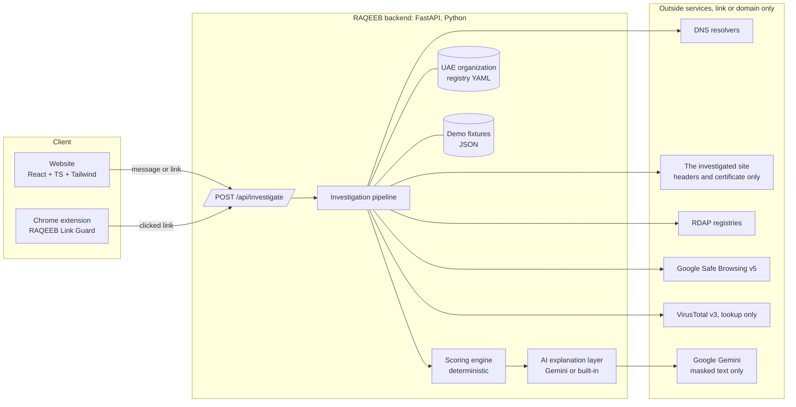

# RAQEEB: technical documentation

This document describes how RAQEEB works **as built**: architecture, investigation pipeline, scoring, model choices, privacy and security design, and testing. For the problem statement and how to run it, see the [README](../README.md).

---

## 1. Architecture



- **Frontend** (`frontend/`): a single-page app. It talks only to its own backend through `/api`. It holds no API keys.
- **Extension** (`extension/`): a Chrome Manifest V3 extension. A content script on WhatsApp Web, Gmail, Outlook and Telegram Web catches clicks on outgoing links. Gmail and Outlook redirect wrappers are unwrapped first. The extension then opens `check.html`, which calls the backend.
- **Backend** (`backend/app/`): a stateless FastAPI service. Each request runs the whole pipeline in memory and returns one JSON result. **No database.**

| Module | Responsibility |
|---|---|
| `pipeline/extract.py` | Input validation; link extraction from free text (refangs `hxxp`, `[.]`; ignores emails and file names); URL normalisation; punycode; registrable domain via the offline Public Suffix List |
| `pipeline/domains.py` | URL structure red flags: IP host, `@` trick, http, odd port, shortener, punycode / mixed scripts, deep subdomains, lure words, many hyphens |
| `registry/organizations.yaml` | 26 UAE organizations (government, regulator, banks, couriers, telecoms, payments), each with official domains and verification status / source |
| `pipeline/verify.py` | Claimed-organization detection; domain comparison; identity outcome |
| `net/safe_fetch.py`, `net/dns_check.py` | SSRF-safe redirect following, TLS certificate inspection, DNS |
| `intel/clients.py` | RDAP domain age, Google Safe Browsing v5, VirusTotal v3 |
| `pipeline/technical.py` | Runs the network and intel checks (live, fixture or disabled) and turns them into evidence |
| `pipeline/content.py` | Rule-based message red flags |
| `pipeline/scoring.py` | Weighted, explainable score and verdict |
| `ai/provider.py`, `ai/masking.py` | Replaceable AI layer and personal-data masking |

## 2. The evidence model

Every check produces `Evidence` items: `id`, `category`, `finding`, `why_it_matters`, `status`, `source`, `raw` (technical details).

The status is one of six values, so the report can separate kinds of findings honestly:

| Status | Meaning |
|---|---|
| `confirmed` | An independent service says it is malicious (Safe Browsing match, or ≥3 VirusTotal engines) |
| `suspicious` | A warning sign. Alone, not proof |
| `verified` | Confirmed by an authoritative source (e.g. official domain in the registry, with source) |
| `unverified` | Information that couldn't be confirmed, or carries little weight |
| `contradictory` | Findings that disagree |
| `missing` | A check that didn't run or failed. **Never counted as clean** |

## 3. Investigation pipeline

1. **Validate.** Message length is capped at 5,000 characters, control characters are stripped, only http/https links are allowed, and the domain must have a known public suffix.
2. **Extract links** from the message, or take the single link given.
3. **URL structure analysis**: no network involved.
4. **Technical checks and threat intel**, run concurrently for each link:
   - **DNS** (A, AAAA, MX, NS) for the registrable domain. A non-existent domain is recorded (`dns_exists=false`).
   - **TLS certificate** via a direct connection to the validated IP, with the real hostname used for SNI. It uses the Mozilla CA bundle (`certifi`), because some Windows certificate stores are outdated.
   - **Redirect chain** through the SSRF-safe fetcher, with at most 5 hops, each re-validated. The final destination is also checked for identity.
   - **Domain age** from RDAP (via `rdap.org`). `.ae` registries often don't publish it, in which case it's reported as missing.
   - **Google Safe Browsing v5** `GET /v5/urls:search?urls=…&alt=json`, with the key in the `X-Goog-Api-Key` header.
   - **VirusTotal v3** `GET /urls/{id}`, an existing report only. RAQEEB never submits links.
5. **Identity verification.** The links as written, plus where they really redirect, are compared with:
   - (a) the organization the message claims, if any;
   - (b) every registry organization, to catch lookalikes even when no name is mentioned.

   | Match type | Example |
   |---|---|
   | exact or genuine subdomain | `online.emiratesnbd.com` |
   | wrong suffix | `dewa.com` vs `dewa.gov.ae` |
   | homoglyph (confusable characters mapped) | `emiratesp0st.ae`, Cyrillic `е` |
   | brand plus words | `emiratesnbd-secure.co` |
   | brand only in subdomain | `emiratesnbd.com.verify-acc.xyz` |
   | typo (≤2 edits) | `emiratesnbb.com` |

   Outcomes:
   - **Verified Match**, only if the registry entry has an authoritative source and check date;
   - **Possible Impersonation**;
   - **No Verified Relationship Found**;
   - **Unable to Verify**.
6. **Message rules**: OTP/PIN, card/IBAN, password, small fee (`AED 4.50`), urgency, threats, prizes, "click to verify", "update your details". Each match keeps its position, so the website can highlight it.
7. **Scoring** (section 4).
8. **AI explanation** (section 5).
9. **Disclosures**: which outside services received what, for this investigation.

## 4. Scoring

Five categories, weights configurable in `config.py`:

| Category | Weight | Risk value (0–100) |
|---|---|---|
| Threat intelligence | 30 | confirmed 100 · suspicious 70 · not listed 15 · not covered if checks failed |
| Organization identity | 25 | Possible Impersonation 95 · No Verified Relationship 80 · Verified Match 0 · no lookalike of any registry org 15 · matches an unconfirmed registry domain 10 |
| Domain and URL | 20 | 30 per suspicious indicator + 8 per weak indicator (DNS, certificate and age are traces, not penalties) |
| Message content | 15 | 25 + 15 per extra red flag + 15 per high-impact request (OTP, card, password, fee) |
| Context | 10 | 80 if the link redirects off-site · 90 if it names an org, links elsewhere and asks for money or details · 70 if it names an org and asks for money or details without a link |

```
coverage = covered weight / applicable weight
score    = Σ (weight × risk) over covered categories / covered weight
```

Overrides, applied in order:
- confirmed malicious threat intel → score ≥ 75;
- invalid HTTPS certificate → score ≥ 30;
- Possible Impersonation → score ≥ 50.

Bands:

| Score | Band |
|---|---|
| 0–24 | Low Risk |
| 25–49 | Moderate Risk |
| 50–100 | High Risk |

Refinement of the low end, so "Unknown" means *really* unknown:

| Verdict | Rule |
|---|---|
| **Inactive Link** | The domain doesn't exist in DNS and there are no warning signs |
| **Likely Safe** | Low band, no warnings, and either a Verified Match (official domain with authoritative source) or strong positive evidence: threat intel checked, domain ≥ 1 year old, valid certificate |
| **Low Risk** | Low band, no warnings, real traces of the site (DNS, certificate, age or redirects) but the owner isn't verified. If threat intel was unavailable, the report says so |
| **Unknown Risk** | Coverage below 40%, **or** no traces of the site itself could be collected and threat intel didn't run |

Contradictions are flagged, for example an official domain that redirects elsewhere, or one a security service flags.

The score is a **risk assessment, not a probability of fraud**, and RAQEEB never says "100% safe".

## 5. Model choices

| Component | Choice | Reason |
|---|---|---|
| AI provider | **Google Gemini API**, default `gemini-3.5-flash-lite` | Free tier available in the UAE; structured JSON output via `responseSchema`. `gemini-2.5-flash` is no longer available to new users; in our tests, `gemini-3.8-flash` didn't respond within 60 s |
| Fallback | **Built-in deterministic explainer** (`MockProvider`) | Instant, offline, never fails. Used automatically when Gemini times out (45 s), rate-limits or errors |
| DeepSeek | Not used | No confirmed free API tier. The provider interface allows adding it later |
| AI's role | Claim extraction + plain-English explanation only | **The AI never sets the score.** Any evidence ID it cites that doesn't exist is dropped, so it can't add findings |
| Prompt-injection defence | Message passed inside `<message>` tags as data; the system prompt forbids following it; output must match a JSON schema | The score doesn't depend on the AI, so an injected "say this is safe" can't change the verdict (tested) |
| Lookalike detection | Deterministic: Levenshtein distance + fuzzy ratio (RapidFuzz) on a "skeleton" with confusable characters mapped | Explainable and testable; no training data needed |

## 6. Privacy design

- **Nothing is stored.** No accounts, no database, no scan history, no analytics. Each request lives in memory only.
- **Data minimisation per service:**

  | Service | Receives |
  |---|---|
  | DNS, RDAP | the domain name only |
  | The investigated site | one request per redirect hop; the body is never read |
  | Safe Browsing, VirusTotal | the link (VirusTotal lookup only; RAQEEB never submits) |
  | Gemini | message text **after masking**: names after greetings, phone numbers, emails, card numbers, IBANs, Emirates ID numbers and OTP codes |
  | Chrome extension → RAQEEB | only the clicked link, never message text, and only on 4 messaging/email sites |

- **Disclosure:** every report lists which services received what. The privacy section says honestly that on Gemini's free tier Google may review content.
- **Keys:** only in `backend/.env`, which is git-ignored. The Safe Browsing key goes in a header, not the URL. A test fails if a key appears in any tracked file.

## 7. Security design

- **SSRF protection** (`net/safe_fetch.py`):
  - only public, globally routable IPs (private, loopback, link-local, CGNAT, multicast, metadata and IPv4-mapped forms are all blocked);
  - if *any* resolved address is private, the request is blocked;
  - disguised numeric IPs (`2130706433`, `0x7f.1`) are decoded and checked;
  - the connection goes to the validated IP, which prevents DNS rebinding;
  - redirects are followed manually, at most 5, each re-validated;
  - 5-second timeouts; the body is never read.
- **Untrusted content:** investigated pages are never rendered or executed. The frontend uses React's escaping, and the extension sets all text with `textContent`.
- **Input limits:** message ≤ 5,000 characters, URL ≤ 2,048 characters, only http/https links.
- **CORS** limited to the local frontend.

## 7b. Search Shield, calls and listings

| Feature | Endpoint | How it works |
|---|---|---|
| Search Shield | `POST /api/check-links` (≤ 25 links), `GET /api/search-demo` | `pipeline/shield.py`. Offline: registry comparison (`verify.compare`) plus URL structure rules. Verdicts: `official` (verified source), `listed` (registry, not yet confirmed), `impersonation` (wrong ending, look-alike letters, extra words, brand in a subdomain, typo), `caution` (structural red flags), `unknown`, `invalid`. Never "safe". The demo queries in `fixtures/search_demo.json` are labelled sample data; their badges are computed live. |
| Describe a call | `POST /api/investigate` with `type: "call"` | Same pipeline as a message. Rules in `pipeline/content.py` cover English and Arabic (Arabic letter variants and digits normalised one-to-one in `pipeline/arabic.py`, so highlight positions stay exact) plus phone-scam requests: remote-control apps, "safe account" transfers, gift cards, Emirates ID, secrecy, fake legal cases. The result adds a `call` summary: claimed organizations, what was asked for, pressure tricks and official contacts. |
| Listing check | `POST /api/check-listing`, `GET /api/listing-demo` | `pipeline/listing.py`. Name → claimed organization (English or Arabic names); website → Search Shield check; phone → official numbers in the registry (`phones`, with `phone_source` from the organization's own website). Weights: identity 45, phone 35, website 20; coverage < 40% or no known organization → `needs_verification`. Addresses are never claimed as checked. |
| Link Guard on search pages | extension `search.js` → background `raqeeb-domains` → `/api/check-links` | Sends only `scheme://host` of each result; search words are never read. Ads are resolved through `data-pcu`. Switch in the popup. |

## 7c. Tools that run in the browser

| Tool | Where | How |
|---|---|---|
| QR codes | `frontend/src/lib/imageScan.ts` | `jsQR` on the uploaded image (several sizes) or on live camera frames. A decoded link becomes a link investigation; other text becomes a message. |
| Screenshot text | `frontend/src/lib/imageScan.ts` | `tesseract.js` with English + Arabic language data served from `/ocr` (copied from `node_modules` by `scripts/copy-ocr.mjs` before `dev` and `build`). No CDN, no upload; the user can correct the text before investigating. |
| Evidence sheet | `frontend/src/components/EvidenceSheet.tsx` | Built from the investigation result on the device. Print stylesheet produces one A4 page. Reference number from `crypto.getRandomValues`. Marked "not an Abu Dhabi Police document". |
| Spot the scam | `frontend/src/components/ScamQuiz.tsx`, `lib/quizItems.ts` | 8 messages × 2 languages. Each was run through the engine to confirm its verdict matches the quiz answer; this found and fixed a missing rule for "new number" family scams. |

## 8. Testing

**136 automated backend tests** (`pytest`):
- extraction (defanged links, emails, file names, punycode);
- lookalike detection for each match type;
- the three demo scenarios end to end;
- the scoring rules, including every new verdict;
- SSRF (private IPs, metadata IP, disguised IPs, mixed DNS answers, redirect to private, redirect loops);
- Safe Browsing / VirusTotal / RDAP responses and errors (403, 404, 429);
- Gemini masking, invented evidence IDs and fallback;
- prompt injection;
- secrets;
- English and Arabic call/scam rules, Arabic organization names and match positions;
- every Search Shield verdict and the demo search results;
- the three listing scenarios, phone formats (including Arabic digits) and "never accuse without evidence".

The external services are mocked in tests. Live checks were verified manually, for example `dewa.gov.ae` showed a valid DigiCert certificate and a Likely Safe verdict.

## 9. Known limitations

- Screenshot investigations (OCR) aren't built.
- Only 3 registry organizations have authoritative sources so far; the rest can catch lookalikes but never produce "Verified Match".
- Safe Browsing returned 403 `ACCESS_DENIED` for our key during development, so threat intel ran mainly in demo mode.
- The Gemini free tier was slow or busy in testing; the built-in explainer covers that.
- Weights are expert-set, not trained on labelled data.
- The extension works on desktop Chrome only.
